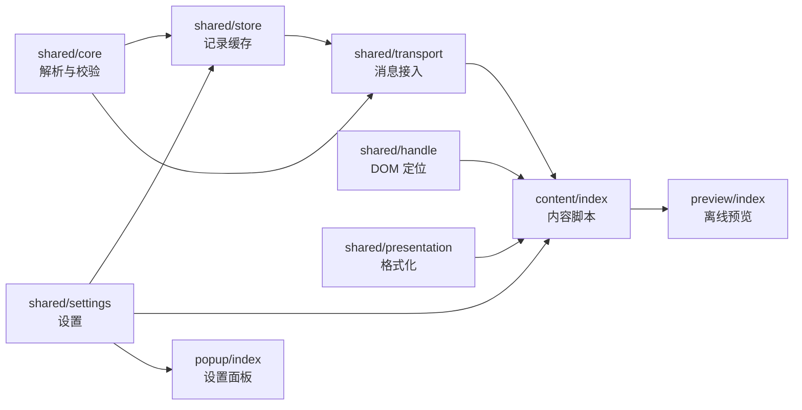

<div align="center">

# X Pulse · 自动粉丝徽标

**打开 X，正常浏览，粉丝数就自动出现在用户名旁边。**

无需填写账号 · 无需 API Key · 不额外发送网络请求 · 零依赖


</div>

一款基于 **Manifest V3** 的浏览器扩展（Chrome / Edge），在浏览 X（Twitter）时自动为推文、评论与用户列表中的账号显示粉丝数徽标。安装后即可使用，不需要指定要监控的账号。

## 目录

- [功能特性](#功能特性)
- [徽标样式](#徽标样式)
- [安装](#安装)
- [使用与设置](#使用与设置)
- [工作原理](#工作原理)
- [支持的字段](#支持的字段)
- [隐私与安全](#隐私与安全)
- [常见问题](#常见问题)
- [开发与构建](#开发与构建)
- [测试](#测试)
- [离线预览](#离线预览)
- [目录结构](#目录结构)
- [版本历史](#版本历史)
- [许可](#许可)

## 功能特性

| 能力 | 说明 |
| --- | --- |
| 自动识别 | 浏览 X 即自动显示，无需手动指定账号，装好即用。 |
| 全场景覆盖 | 推文、评论、关注 / 粉丝列表、推荐关注均自动补充；窄侧栏只显示人数。 |
| 滚动即更新 | 向下滚动加载新内容时自动补充新徽标。 |
| 虚拟列表安全 | X 复用旧 DOM 元素时会清除错位徽标，避免把 A 的人数显示给 B。 |
| 两级人数 | 默认紧凑显示（`1.29万`）；悬停或 Tab 聚焦查看精确人数（`12,984`）。 |
| 悬停卡片 | 展示关注数、发布数量、粉丝 / 关注比、关注关系、加入时间与采集时刻。 |
| 分级配色 | 按粉丝量灰 / 蓝 / 青绿 / 金 / 紫分级；互关、关注了你显示为小标签。 |
| 自适应布局 | 空间不足时自动从“用户名旁”换行到“单独一行”，避免挤压原文。 |
| 实时生效 | 设置改动即时应用，关闭总开关立刻移除页面上的全部徽标。 |
| 诊断模式 | 页面左下角显示采集状态（响应 / 解析 / 用户 / 徽标数），便于排查。 |
| 零打扰 | 不额外打开标签页，不定时刷新，不输入账号，不使用 API Key，不主动请求 X 接口。 |

## 徽标样式

徽标根据粉丝量分档配色（阈值见 `src/shared/presentation.js` 的 `tier`）：

| 档位 | 粉丝量 | 颜色 |
| --- | --- | --- |
| `0` | < 1,000 | 灰 |
| `1` | ≥ 1,000 | 蓝 |
| `2` | ≥ 10,000 | 青绿 |
| `3` | ≥ 100,000 | 金 |
| `4` | ≥ 1,000,000 | 紫（渐变） |

人数展示支持两种模式：

- **紧凑**：`1.29万`（过万用“万 / 亿”，向下取整，避免把 `999,999` 显示成 `100万`）。
- **精确**：`12,984`。

悬停卡片展示：名称、`@handle`、精确粉丝数、关注数、发布数量、粉丝 / 关注比、关注关系（互关 / 关注了你）、加入 X 时间，以及本条数据的采集时刻。缺失字段保持未知，**不编造为 `0`**。

## 安装

1. 下载或克隆本仓库。
2. 打开 `chrome://extensions`（Edge 为 `edge://extensions`），开启右上角 **开发者模式**。
3. 点击 **加载已解压的扩展程序**，选择构建产物所在的 `dist` 文件夹。
4. **对已打开的 X 页面按 `Ctrl+Shift+R` 强制刷新**，然后正常浏览首页、评论、搜索结果或关注 / 粉丝列表即可。

> **从旧版本升级**：请先在扩展管理页停用旧的 X Pulse，避免新旧代码同时运行；或直接覆盖旧插件目录后点“重新加载”，再刷新所有 X 页面。旧版已打开的监测标签页可自行关闭。

## 使用与设置

点击工具栏中的扩展图标打开设置面板。可用设置项及其默认值：

| 设置项 | 类型 | 默认 | 说明 |
| --- | --- | --- | --- |
| 自动显示粉丝数 | 开关 | 开 | 总开关，关闭后立即移除页面上的徽标 |
| 徽标位置 | 下拉 | `自动适应宽度` | `自动适应宽度` / `放在用户名旁` / `单独一行` |
| 人数显示 | 下拉 | `紧凑：1.29万` | `紧凑：1.29万` / `精确：12,984` |
| 按粉丝量配色 | 开关 | 开 | 依据粉丝数使用不同颜色档位 |
| 悬停显示详情 | 开关 | 开 | 展示精确人数、关注数量、关注关系等 |
| 显示互关 / 关注了你 | 开关 | 开 | 是否展示关注关系标签 |
| 显示诊断信息 | 开关 | 关 | 在页面左下角显示采集状态，用于排查 |

> 首次安装或更新后，务必刷新 X 页面，让新脚本生效。设置保存在本机，改动即时应用。

## 工作原理

扩展分为三个环节，核心思路是**在页面主世界只做“旁路观察”，把解析放到扩展隔离环境**：

```
X 页面请求 ──▶ bridge.js（页面主世界 MAIN）
                  │  包装 window.fetch / XMLHttpRequest
                  │  仅监听 X 数据接口响应，转成纯 JSON 文本
                  ▼  window.postMessage（同源消息）
             content.bundle.js（扩展隔离环境 ISOLATED）
                  │  解析响应，提取用户与粉丝字段，去重与校验
                  ▼
             content/index.js ──▶ DOM 定位用户名 / 用户单元，插入徽标
```

1. **页面主世界观察（`bridge.js`，`world: MAIN`）**：包装 `window.fetch` 与 `XMLHttpRequest`，仅对 X / `api.x.com` 的 GraphQL、`1.1`、`2` 数据接口响应做旁路读取，并把响应体序列化为纯 JSON 文本后通过同页 `postMessage` 传出。原始请求与响应保持原样，绝不修改。
2. **隔离环境解析（`content.bundle.js`，`world: ISOLATED`）**：扩展隔离环境接收 JSON 文本再解析，避免与页面脚本共享对象、变量或原型。消息版本为 `x-pulse:response:v2`，附带体积上限与来源校验。
3. **数据落位（`src/content/index.js`，打包进 `content.bundle.js`）**：在页面 DOM 中定位 `[data-testid="User-Name"]` 与 `UserCell`，插入徽标；并通过 `MutationObserver` 在滚动、列表复用、设置变更时实时校准，复用行时清除旧徽标。

缓存策略：每个标签页最多缓存 **3000** 个用户，单次响应最多提取 **300** 个用户，响应文本上限 **12,000,000** 字符；旧数据不会覆盖更新的数据。

## 支持的字段

解析时按以下优先级取字段，兼容 X 的多种响应结构：

| 数据 | 字段优先级 |
| --- | --- |
| 粉丝数 | `relationship_counts.followers` → `relationship_counts.followers_count` → `legacy.followers_count` → `public_metrics.followers_count` → `followers_count` |
| 关注数 | `relationship_counts.following` → `relationship_counts.following_count` → `legacy.friends_count` → `public_metrics.following_count` |
| 发布数量 | `tweet_counts.tweets` → `legacy.statuses_count` → `public_metrics.tweet_count` |
| 用户名 | `core.screen_name` → `legacy.screen_name` → `screen_name` → `username` |
| 显示名 | `core.name` → `legacy.name` → `name` |
| 头像 | `avatar.image_url` → `legacy.profile_image_url_https` → `profile_image_url_https`（仅接受 `pbs.twimg.com` 的 HTTPS 地址） |
| 关注关系 | `relationship_perspectives.followed_by` / `.following`（互关、关注了你） |

数值只接受非负安全整数（含纯数字字符串），**近似值如 `1.2M` 一律不采信**，避免误读。

## 隐私与安全

- **权限最小化**：仅声明 `storage` 权限，外加 `x.com` / `twitter.com` 页面脚本；不读取 Cookie 或请求头，不使用 `debugger`，不申请全站权限（`<all_urls>`）。
- **不外发数据**：完整响应只在内存中短暂用于解析，**不写入存储、不上传任何服务器**。
- **本机存储**：设置保存在浏览器本地存储；观测数据只存在当前标签页内存，刷新或关闭页面即清空。
- **不主动请求**：扩展不主动访问 X 接口，只观察页面本身已经发出的请求。
- **自动显示 ≠ 后台轮询**：只有 X 页面收到新数据时才会更新；没有新响应就不会产生新人数，悬停卡片会标注采集时刻。
- **页面零副作用**：请求 / 响应原样透传，页面脚本行为不受影响；写入页面的样式均以 `!important` 隔离并限定作用域。

## 常见问题

| 现象 | 可能原因与处理 |
| --- | --- |
| 完全看不到徽标 | 先刷新 X，再滚动加载几条新推文；打开“显示诊断信息”观察数据流。 |
| 响应 / 用户均为 0 | 当前页面未采集到含用户信息的响应，或 X 调整了请求方式。 |
| 用户 > 0 但徽标为 0 | X 调整了页面 DOM 结构，需要适配选择器。 |
| 只有部分账号有徽标 | 尚未收到这些账号的用户对象，或响应里没有粉丝字段（属正常）。 |
| 升级后没变化 | 旧脚本仍在运行：停用旧版并强制刷新所有 X 页面。 |
| 登录 / 验证码问题 | 需在 X 侧正常处理，插件不处理验证码、不绕过页面限制。 |

> 浏览器需要能正常访问 X 并按 X 要求登录。插件不处理验证、不绕过任何页面限制。

## 开发与构建

源码为原生 JavaScript，**零依赖**。源文件按层组织在 `src/` 下，使用 CommonJS（`require` / `module.exports`）；[`build.cjs`](./build.cjs) 是一个零依赖的小型打包器，把这些模块合并为自包含的 IIFE 包并输出到 `dist/`。运行时不使用任何跨文件的 `window` / `globalThis` 模块引用。

模块关系：



修改源码后重新构建并测试：

```bash
node build.cjs
node --test tests/*.test.cjs
```

- [`build.cjs`](./build.cjs)：将 `src/` 下的模块打包为 `dist/content.bundle.js`、`dist/popup.bundle.js`、`dist/preview.bundle.js`，并把 HTML / CSS / 图标复制到 `dist/`。
- 构建产物已包含在仓库的 `dist/` 目录中，解压即可加载；**修改源码后请重新运行构建**，否则页面仍运行旧代码。

## 测试

`tests/` 下包含 **32 项** 自动测试，覆盖：

| 测试文件 | 覆盖范围 |
| --- | --- |
| `core.test.cjs` | 句柄规整、多版本用户结构解析、数值校验、头像白名单、零值与缺失值区分 |
| `lens.test.cjs` | 设置校验、数字格式化边界、乱序数据、缓存上限与签名 |
| `bridge.test.cjs` | fetch / XHR 透传、非目标响应不解析、异常不影响宿主页面 |
| `render.test.cjs` | 模拟 DOM 下的自动插入、重复渲染、开关、虚拟列表复用、悬停转义 |

其中**完整链路测试**在两个独立 JavaScript 环境中运行真实请求桥与最终安装包脚本，不预先注入核心模块，以防再次漏掉依赖初始化问题。最近一次结果见 [`tests/verification.txt`](./tests/verification.txt)。

> **注意**：当前开发环境未登录 X，尚未完成真实账号、已安装插件的端到端验证。模拟 DOM 测试不等于真实页面兼容性验证，X 后续改版可能需要更新字段或选择器。

## 离线预览

双击打开 [`dist/preview.html`](./dist/preview.html)，可在不安装扩展的情况下查看徽标与悬停卡片的真实渲染效果（含明暗主题切换、紧凑 / 精确人数切换）。页面内容与人数全部为示例数据，不连接 X、不发起任何请求。

## 目录结构

```
x-pulse-auto/
├── src/                        # 源码（按层与职责组织）
│   ├── manifest.json           # 扩展清单（MV3，版本由 version.js 注入）
│   ├── version.js              # 版本号单一来源
│   ├── background.js           # 服务工作者：升级时清理旧版定时任务
│   ├── page/
│   │   └── bridge.js           # 页面主世界：监听 fetch / XHR 响应并透传
│   ├── shared/                 # 领域逻辑（无 DOM 副作用）
│   │   ├── core.js             # 核心解析：句柄规整、用户提取、样本校验
│   │   ├── settings.js         # 设置默认值与校验
│   │   ├── presentation.js     # 数字格式化 / 配色档位 / 关系标签
│   │   ├── store.js            # 记录缓存与渲染签名
│   │   ├── transport.js        # 消息接入（版本 / 体积校验）
│   │   └── handle.js           # DOM → 句柄定位
│   ├── content/                # 内容脚本（高内聚拆分）
│   │   ├── index.js            # 编排入口（组合根，持有共享状态）
│   │   ├── dom.js              # DOM 小工具
│   │   ├── tooltip.js          # 悬停卡片
│   │   ├── badge.js            # 徽标元素
│   │   ├── layout.js           # 布局与落位
│   │   ├── observer.js         # MutationObserver 调度
│   │   └── diagnostics.js      # 诊断 HUD 与状态上报
│   ├── popup/                  # 设置面板（index.js / popup.html / popup.css）
│   ├── preview/                # 离线预览（index.js / preview.html）
│   └── styles/content.css      # 徽标 / 悬停卡片 / 诊断条样式
├── dist/                       # 构建产物（加载此目录，已包含在仓库中）
│   ├── manifest.json
│   ├── content.bundle.js / popup.bundle.js / preview.bundle.js
│   ├── background.js / bridge.js
│   ├── content.css / popup.html / popup.css / preview.html
│   └── icons/
├── build.cjs                   # 零依赖构建脚本
├── tests/                      # 自动测试（32 项）
├── icons/                      # 扩展图标（16 / 48 / 128）
└── LICENSE                     # MIT 许可
```

## 版本历史

### 1.1.1

修复用户反馈的 `Cannot read properties of undefined (reading 'validateSample' / 'normalizeHandle')`：将核心解析、校验和渲染合并为单文件入口，内部使用私有变量传递依赖，不再依赖跨文件的 `globalThis.XPulseCore`；页面响应经 JSON 文本桥接后在插件隔离环境中解析。新增数字字符串兼容、具体错误诊断、页面脚本版本检查和完整链路回归测试。

### 1.1.0

调整为自动行内展示方向：不再需要指定账号，浏览即自动显示徽标，移除后台轮询与标签页刷新。

## 许可

本项目以 MIT 许可发布。

本项目与 X Corp. 无隶属关系。
