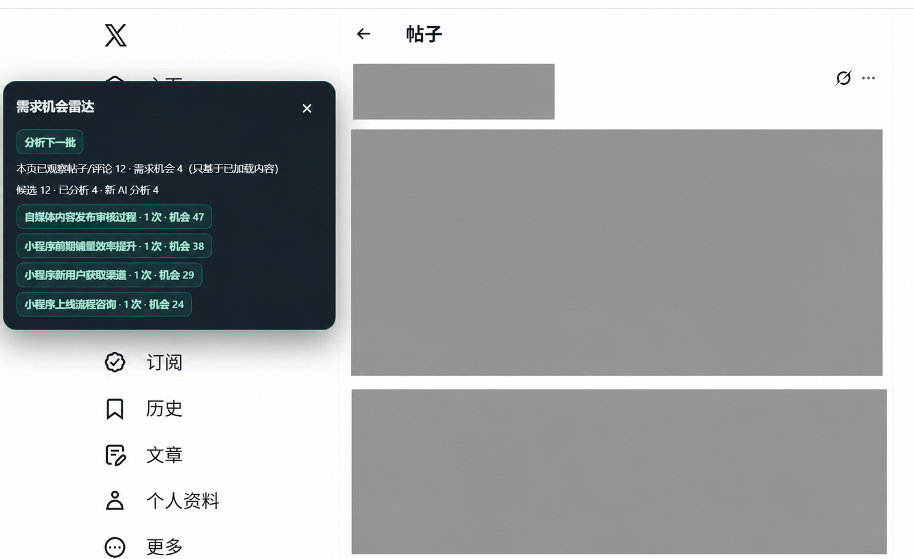
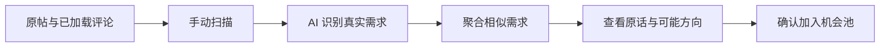
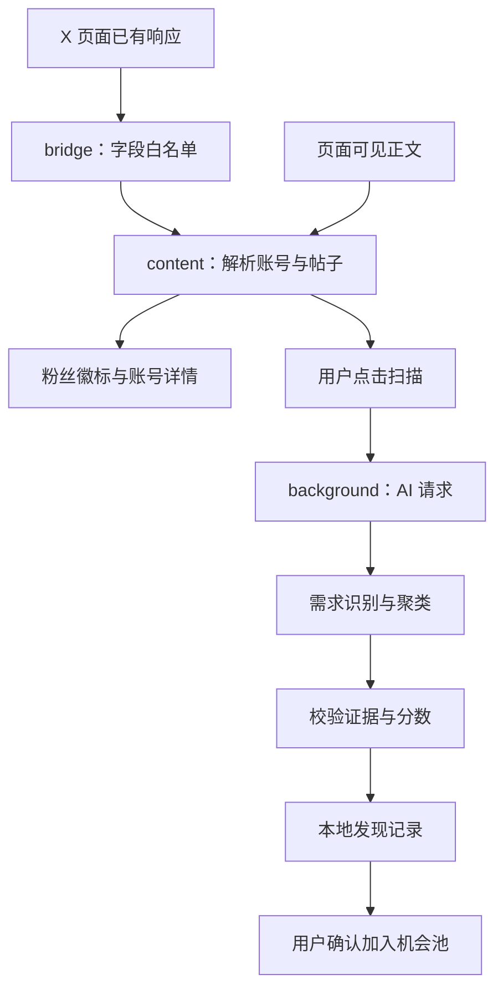

<div align="center">


# X Pulse · 需求机会雷达

**刷 X，看清账号，也看看大家真正需要什么。**

自动粉丝徽标 · 原帖与评论分析 · 相似需求聚类 · 个人机会池


[功能特性](#功能特性) · [界面预览](#界面预览) · [快速开始](#快速开始) · [使用指南](#使用指南) · [常见问题](#常见问题)

</div>

X Pulse 是一款适用于 **Chrome / Edge** 的浏览器扩展。正常浏览 X 时，它会在账号旁补充粉丝数；遇到值得研究的讨论，点击扫描，就能从原帖和评论中整理需求、痛点、付费信号，以及可能可以做的产品或服务。

**先看看人们在为什么事发愁，再决定自己可以做什么。** 相似需求会被归成一张机会卡，感兴趣的再由你确认加入机会池。

> 粉丝徽标安装后即可使用；需求雷达需要配置你自己的 OpenAI 兼容 AI 服务。项目使用原生 JavaScript、Manifest V3，零第三方运行依赖。

## 功能特性

### 🔎 从讨论中发现需求

| 功能 | 使用体验 |
| --- | --- |
| **原帖 + 评论分析** | 扫描当前页面已观察到的帖子与评论，结合可用的父帖上下文判断需求。原帖本身也会参与分析。 |
| **需求识别** | 寻找求推荐、明确痛点、重复劳动、寻找方案、愿意付费等信号，由 AI 判断具体语境。 |
| **相似需求聚类** | 将表达不同、问题相近的讨论归为一个需求主题，集中查看出现次数与典型原话。 |
| **机会分析** | 展示需求强度、痛点、目标用户、付费信号、当前方案与竞争线索，并给出可做的产品或服务方向。 |
| **个人机会池** | 手动确认后加入；支持收藏、备注、标签和移出，方便继续研究。 |
| **搜索与排序** | 按需求、痛点、目标用户或可能方向搜索；按机会评分、出现次数、最近更新排序。 |
| **可拖动悬浮面板** | 随时查看扫描进度和本页相关需求；拖动标题栏调整位置，关闭后可通过小入口重新打开。 |
| **手动分批扫描** | 一次最多处理 100 条候选讨论，AI 请求每批最多 10 条；加载更多内容后继续分析。 |

### 👤 保留熟悉的账号增强

| 功能 | 使用体验 |
| --- | --- |
| **自动粉丝徽标** | 在帖子、评论和用户列表中，为已获取到数据的账号补充粉丝数。 |
| **账号详情** | 悬停或键盘聚焦查看精确人数、关注数、发布数量、粉丝／关注比、账号年龄及关注关系。 |
| **自适应展示** | 支持紧凑／精确人数、按粉丝量配色，以及用户名旁／单独一行／自动适应宽度三种布局。 |
| **独立账号收藏** | 收藏账号、添加备注、搜索记录，并导出 CSV 或 JSON；与需求机会池分别管理。 |
| **滚动与列表适配** | 随页面加载补充徽标，处理 X 虚拟列表复用，避免旧徽标留在另一个账号旁。 |

## 界面预览

<p align="center">
  
</p>

<p align="center"><sub>界面脱敏展示：人物信息、帖子正文与配图已遮挡。点击需求主题可查看详情，再决定是否加入机会池。</sub></p>

截图中的评分与次数来自当次扫描样本，仅展示功能效果。

## 快速开始

### 1. 加载扩展

1. 下载并解压本仓库，或通过 Git 克隆。
2. 打开 `chrome://extensions`，Edge 用户打开 `edge://extensions`。
3. 开启右上角的 **开发者模式**。
4. 点击 **加载已解压的扩展程序**，选择仓库中的 **`dist/` 文件夹**。
5. 刷新已经打开的 X 页面，正常浏览即可看到已获取数据的账号徽标。

仓库已包含构建产物，安装时无需运行 `npm install`。如修改了源码，先运行 `node build.cjs`。

> **更新扩展后**：在扩展管理页点击“重新加载”，再刷新所有已打开的 X 页面，让新脚本生效。

### 2. 连接 AI 服务

点击浏览器工具栏中的扩展图标，展开 **AI 设置**：

| 配置 | 填写说明 |
| --- | --- |
| API Base URL | 服务商提供的兼容接口地址，例如 `https://api.example.com/v1`；扩展会拼接 `/chat/completions`。 |
| API Key | 你在该服务商申请的密钥；再次保存时留空可保留已有 Key。 |
| Model | 服务商支持的准确模型名称。 |
| Temperature | 默认 `0.2`，允许范围 `0–2`；需符合所选模型的要求。 |
| Timeout | 默认 `30000` 毫秒，即 30 秒；允许范围为 1–120 秒。 |

点击 **测试连接并授权域名**，按提示授予该服务域名权限。测试成功后即可扫描，无需填写产品配置。AI 调用费用按你所选服务商的规则计算。

### 3. 扫描并留下值得研究的机会

打开一条帖子，等原文与评论加载后，点击悬浮面板中的 **扫描当前页面**。也可以从扩展面板点击 **扫描当前 X 页面** 启动。



## 使用指南

### “分析下一批”会分析什么？

它会继续处理**当前页面已观察到、尚未分析的帖子与评论**。一次点击最多处理 100 条候选；已处理且内容未变的讨论会跳过，符合条件的历史结果也会复用本地缓存。

想分析后面的评论，先在 X 页面向下滚动，或展开更多回复，让内容加载出来，再点击 **分析下一批**。扩展不会自动翻页或主动抓取未加载的评论。

面板中的统计含义：

| 指标 | 含义 |
| --- | --- |
| 本页已观察帖子／评论 | 当前页面浏览过程中已识别到、有可用正文的讨论数量。 |
| 需求机会 | 与本页讨论相关的需求主题数量；相似讨论可能归为同一主题。 |
| 候选 | 本次扫描选取时，通过本地初筛的讨论总数，可能包含之前已分析的内容。 |
| 已分析 | **本次点击**已处理的讨论数，包含缓存命中。 |
| 新 AI 分析 | 本次没有命中缓存、实际交给 AI 分析的讨论数。 |

### 一张需求机会卡包含什么？

例如，“有没有视频批量制作工具”和“每天手动做几十条视频太累了”，可能被归到 **AI 视频批量生产需求**。这是聚类方式的示例，实际归类由讨论内容决定。

| 信息 | 帮助你判断什么 |
| --- | --- |
| 需求名称、出现次数 | 什么问题反复出现，在已扫描样本中出现了多少次。 |
| 典型原话、原讨论入口 | 判断依据是什么，方便回到 X 核对上下文。 |
| 用户痛点、目标用户 | 谁遇到了问题，具体卡在哪里。 |
| 付费信号 | 是否明确提到付款、预算、采购或价格。 |
| 当前方案、竞争线索 | 讨论中提到了哪些替代方案，仍有哪些不满。 |
| 需求趋势 | 有足够日期跨度的扫描样本时，展示样本内的变化。 |
| 需求强度、机会评分 | 帮助比较线索，安排进一步研究的顺序。 |
| 可能可以做／卖 | 可以继续验证的工具、插件、工作流或服务方向。 |

点击 **加入机会池** 后，可在扩展面板中切换到 **机会池**，继续收藏、写备注、加标签。移出机会池会保留发现记录。

> 次数来自已扫描的不同帖子，趋势和竞争判断也只基于这些样本。证据不足时显示“样本不足”；评分是研究线索，不代表已经验证过市场需求。

### 粉丝徽标与账号收藏

在扩展面板中展开 **粉丝徽标与账号收藏**，可以调整自动显示、位置、人数格式、配色和悬停详情。设置保存后会应用到页面。

| 粉丝量 | 徽标配色 |
| --- | --- |
| 少于 1,000 | 灰 |
| 1,000–9,999 | 蓝 |
| 10,000–99,999 | 青绿 |
| 100,000–999,999 | 金 |
| 1,000,000 及以上 | 紫色渐变 |

紧凑模式显示如 `1.29万`，精确模式显示如 `12,984`。缺失字段保持未知，不用 `0` 代替。通过账号详情卡片收藏账号后，可在扩展面板搜索、编辑备注或导出 CSV／JSON。

## 常见问题

<details>
<summary><strong>原帖正文也会被分析吗？图片里的文字呢？</strong></summary>

原帖和评论都会独立参与需求判断。优先复用 X 页面已有响应中的正文；没有缓存到文本时，使用页面上已显示的正文兜底。目前分析的是可读取的帖子文字，不包含图片 OCR 或视频内容识别。

</details>

<details>
<summary><strong>为什么扫描了很多条，只有几个需求机会？</strong></summary>

普通闲聊、广告和缺少具体问题的内容可能不会被判定为需求；相似的需求也会归成一张卡。因此扫描条数、需求条数和机会主题数并不相同。出现次数可能包含以前扫描并归入同一主题的讨论。

</details>

<details>
<summary><strong>连接测试失败，或提示 AI 返回空内容，怎么办？</strong></summary>

先检查 Base URL、模型名称和 API Key，并确认已授予服务域名权限。失败提示会展示可用的 HTTP 状态和服务商错误；空响应会显示服务返回的结束原因及 token 用量。

如果结束原因为 `length`，说明本次输出达到了上限。推理模型可能在产生正文前耗尽额度，可以检查服务商的推理设置或换用其他兼容模型。超时可适当调高 Timeout。扩展不会自动重复失败请求，修正后手动重试即可。

</details>

<details>
<summary><strong>悬浮面板挡住内容，或者关闭后找不到了？</strong></summary>

按住面板标题栏拖动到合适的位置。点击右上角 × 可关闭面板；页面右下角会留下“需求雷达”按钮，点击即可重新打开。

</details>

<details>
<summary><strong>升级后没变化，或者没有粉丝徽标？</strong></summary>

先在扩展管理页重新加载扩展，再刷新 X 页面，并滚动加载新内容。部分账号尚未返回粉丝字段时不会显示徽标。可开启“显示诊断信息”，检查响应、用户和徽标数量；X 页面结构变化也可能需要适配。

</details>

<details>
<summary><strong>旧版功能和已有数据怎么处理？</strong></summary>

V4 保留粉丝徽标、账号详情、独立账号收藏及导出。V2 的推文指标、互动率高亮和关键词过滤已移除；V3 的产品匹配扫描改为需求发现，不再要求填写“我的产品”。

旧产品配置、旧评论商机数据和账号收藏不会主动删除。旧产品配置与评论商机不参与新扫描，也不会自动转成需求机会。

</details>

## 数据与隐私

| 数据／行为 | 处理方式 |
| --- | --- |
| X 页面数据 | 观察页面已产生的响应，并读取已显示的帖子正文；不主动请求 X API，不后台轮询。 |
| AI 请求 | 仅由用户点击触发测试或扫描，通过扩展后台请求所配置的服务。 |
| 发送给 AI 的内容 | 选中的帖子文本、可用父帖上下文、发布时间和已有需求主题摘要。 |
| 不发送的内容 | Cookie、X Token、请求头、完整 X 响应。 |
| 本地保存 | AI 设置、分析缓存、需求记录、机会池、收藏、备注与标签；不做云同步。 |
| API Key | 保存在扩展本地存储中，用于后台请求 AI；配置读取接口只返回是否已保存 Key。 |
| 域名权限 | 测试连接时按所填服务域名申请可选权限；没有 `<all_urls>` 必需权限。 |

为支持自定义 AI 服务，Manifest 声明了 HTTPS 等可选主机范围，实际申请的是所填服务域名。AI 服务会收到你提交的讨论文本，其保存与处理方式取决于该服务商。

## 开发与构建

源码使用原生 JavaScript 和 CommonJS 模块，构建由仓库自带的零依赖打包器完成。准备好支持 `node:test` 的 Node.js 环境后运行：

```bash
node build.cjs
node --test tests/*.test.cjs
```

构建结果输出到 [`dist/`](./dist/)。修改源码后重新构建，在扩展管理页重新加载，再刷新 X 页面。

### 工作原理



<details>
<summary><strong>展开目录结构</strong></summary>

```text
X-Pulse-Auto/
├── src/
│   ├── manifest.json           # Manifest V3 清单
│   ├── version.js              # 版本号来源
│   ├── background.js           # 后台请求、消息路由与串行写入
│   ├── page/bridge.js          # 页面响应观察与字段白名单
│   ├── content/               # 粉丝徽标、详情卡、悬浮雷达
│   ├── popup/                 # 设置、账号收藏与需求机会池
│   ├── shared/                # 解析、AI、校验、聚类、存储与导出
│   ├── preview/               # 徽标离线预览
│   └── styles/content.css     # 页面增强样式
├── dist/                      # 可直接加载的扩展构建产物
├── tests/                     # 自动测试与验证记录
├── docs/                      # 界面截图与历史设计文档
├── icons/                     # 扩展图标
├── build.cjs                  # 零依赖打包器
└── LICENSE                    # MIT
```

</details>

### 测试与离线预览

最近记录为 **94 项测试通过**，详见 [`tests/verification.txt`](./tests/verification.txt)。覆盖响应桥、账号解析、徽标和收藏回归、AI 错误处理、证据校验、聚类与缓存、机会池、扫描上限、原帖正文兜底、虚拟列表及悬浮面板交互。

双击打开 [`dist/preview.html`](./dist/preview.html)，可离线预览粉丝徽标与悬停卡片，支持主题与人数格式切换。预览使用示例数据；需求雷达需在 X 页面连接你配置的 AI 服务体验。

自动测试不能替代真实 X 页面与不同 AI 服务的端到端验证，页面改版或接口差异可能需要进一步适配。

## 版本历史

| 版本 | 主要变化 |
| --- | --- |
| **4.0.0 · 当前** | 从产品匹配转向需求发现；分析原帖与评论，聚合需求，给出可能方向；确认后加入机会池。新增可拖动、可关闭的悬浮雷达，并完善 AI 连接错误提示。 |
| **3.0.0** | 引入基于产品配置的评论商机扫描、AI 接入与本地商机管理；精简 V2 推文指标、高亮及过滤功能。 |
| **2.0.0** | 增加账号分析、推文指标、内容筛选、账号收藏与 CSV／JSON 导出。 |
| **1.1.x** | 自动粉丝徽标、隔离环境解析、页面响应桥、诊断与完整链路回归。 |

## 许可

本项目以 [MIT License](./LICENSE) 发布，与 X Corp. 无隶属关系。
