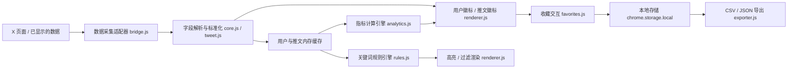

# X-Pulse-Auto V2.0 开发实施方案

技术设计 V1.0 · 原生 JavaScript · Manifest V3 · 零第三方依赖

> 目标：将 X-Pulse-Auto 从自动粉丝徽标插件，升级为集账号分析、推文分析、内容筛选、本地收藏于一体的 X 浏览增强工具。
>
> 本方案只提供设计与开发任务。文件结构基于旧扁平结构编写；当前仓库已重构为 `src/` 分层，映射关系见 [《V2.0-现状差异对照.md》](./V2.0-现状差异对照.md)。

## 一、开发范围与优先级

| ID    | 模块            | 核心功能              | 优先级 |
| ----- | ------------- | ----------------- | --- |
| XP-01 | 用户增强徽标        | 粉丝数、粉关比、账号年龄、关系展示 | P0  |
| XP-02 | 推文数据增强        | 点赞、评论、转发、引用、浏览量   | P0  |
| XP-03 | 互动率分析         | 浏览互动率、指标缺失处理      | P0  |
| XP-04 | 账号分级标签        | 粉丝档位、自定义阈值、颜色     | P0  |
| XP-05 | 内容高亮          | 高互动推文、命中关键词的视觉突出  | P1  |
| XP-06 | 关键词过滤         | 屏蔽词、关注词、隐藏及恢复     | P1  |
| XP-07 | 账号收藏与备注       | 本地收藏账号、添加标签和备注    | P1  |
| XP-08 | CSV / JSON 导出 | 导出收藏信息、配置和备注      | P1  |

### 非目标

V2 暂不开发 AI 接口、自动关注、自动点赞、自动评论、批量私信、后台爬取或粉丝增长曲线。也不新增数据库、外部服务器、定时抓取任务。

### 技术约束

- 保留现有 `core.js`、`lens.js`、`content.js` 等模块，增量改造。
- 保留现有 `build.cjs`，扩展其打包模块列表。
- 优先沿用现有 `storage` 权限，不申请全站访问权限。
- 不改变 X 原有请求参数、响应内容和正常交互。
- 不自动持久化浏览记录，只有用户明确收藏的内容落盘。
- 新功能均可独立开关，关闭后移除对应 UI。
- 任何缺失的数据标记为未知，不能自动当成零。

## 二、整体模块设计



建议把现有 `content.js` 的解析、业务计算、规则匹配和 DOM 渲染进一步分离，避免继续将所有业务堆到一个文件中。

### 2.1 文件结构

以下为建议结构（旧扁平命名），标注 NEW 的文件尚不存在；实际落点见差异对照文档。

```
X-Pulse-Auto/
├── manifest.json
├── background.js
├── bridge.js
├── core.js                 # 用户字段解析，保留
├── lens.js                 # 兼容层、格式化、设置
├── content.js              # 页面主控制器
├── content.css
│
├── tweet.js                # NEW 推文数据解析
├── analytics.js            # NEW 指标计算
├── rules.js                # NEW 关键词/高亮规则
├── favorites.js            # NEW 收藏与备注
├── exporter.js             # NEW CSV/JSON 导出
├── renderer.js             # NEW UI 渲染
├── config.js               # NEW V2 设置校验
│
├── popup.html
├── popup.js
├── popup.css
├── build.cjs
│
└── tests/
    ├── core.test.cjs
    ├── lens.test.cjs
    ├── bridge.test.cjs
    ├── render.test.cjs
    ├── tweet.test.cjs      # NEW
    ├── analytics.test.cjs  # NEW
    ├── rules.test.cjs      # NEW
    ├── favorites.test.cjs  # NEW
    └── exporter.test.cjs   # NEW
```

`renderer.js` 负责 UI，`analytics.js` 只做计算，`rules.js` 只返回判断结果，避免相互依赖。

> 特别注意：当前 `build.cjs` 使用模块表将 `src/` 下的 CommonJS 模块打包为自包含 IIFE。V2 新模块也应通过显式依赖注入（`require` / `module.exports`），不能重新使用跨文件的 `globalThis.XPulseCore`，否则可能重现之前的 `validateSample` 未定义错误。

## 三、核心数据结构

建议统一数据模型，避免模块之间重复处理字段。

### 3.1 用户数据模型 `UserRecord`

```js
/**
 * @typedef {Object} UserRecord
 * @property {string|null} id
 * @property {string} handle
 * @property {string} name
 * @property {number|null} followers
 * @property {number|null} following
 * @property {number|null} posts
 * @property {string|null} createdAt
 * @property {boolean|null} followsYou
 * @property {boolean|null} youFollow
 * @property {number} observedAt
 */
```

字段要求：

- `id`：优先使用 X 的稳定用户 ID。
- `handle`：标准化为小写，不包含 `@`。
- `followers`、`following`、`posts`：只接受非负安全整数。
- `createdAt`：使用可解析的时间，不允许未来日期。
- `observedAt`：本次实际接收数据的时间戳。
- `null`：代表未知，不能被零代替。

> 当前 `core.js` 已提取用户 ID，但 `lens.js` 中的 `sanitize()` 没有将它保留下来。V2 必须修复这条数据链路。

### 3.2 推文数据模型 `PostRecord`

```js
/**
 * @typedef {Object} PostRecord
 * @property {string} id
 * @property {string|null} authorId
 * @property {string|null} authorHandle
 * @property {string} text
 * @property {Object} metrics
 * @property {number} observedAt
 */
```

示例：

```js
const post = {
  id: "1234567890123456789",
  authorId: "123456",
  authorHandle: "creator",
  text: "分享一个新的 AI 工作流",
  metrics: {
    likes: 1420,
    replies: 86,
    reposts: 214,
    quotes: 21,
    views: 86000
  },
  observedAt: 1791619200000
};
```

> 数值仅为示例。不要将 `PostRecord` 自动保存到 `chrome.storage.local`。它只用于当前页面的数据计算和渲染。

### 3.3 V2 设置模型

兼容原来的 `xp_inline_settings` 存储键，新增设置字段，而不是删除旧配置。

```js
const defaultSettings = {
  schemaVersion: 2,

  enabled: true,

  account: {
    showFollowers: true,
    showRatio: true,
    showAge: true,
    showTier: true
  },

  post: {
    enabled: true,
    showEngagementRate: true,
    highlightHighEngagement: false,
    rateThreshold: 2,
    minViews: 1000
  },

  filters: {
    enabled: false,
    mode: "highlight",
    includeKeywords: [],
    excludeKeywords: []
  },

  favorites: {
    enabled: true
  }
};
```

旧版的 `layout`、`format`、`tierColors`、`hoverCard`、`showRelation`、`debug` 等字段仍需保留。

建议由 `config.js` 统一完成：

- 默认值合并。
- 数据类型校验。
- 旧版本设置迁移。
- 数值范围限制。
- 未知配置字段过滤。

## 四、8 个功能模块的开发任务

### XP-01 用户增强徽标（P0）

目标：不打开用户主页，也能看到该账号的主要信息。

具体任务：

- 保留现有粉丝数显示。
- 新增粉关比计算。
- 新增账号注册年限计算。
- 在悬停卡片中补充账号信息。
- 允许分别开启或关闭各项指标。
- 保持深色、浅色主题兼容。
- 修复用户 ID 在解析链路中丢失的问题。

展示逻辑：

| 字段   | 显示示例   |
| ---- | ------ |
| 粉丝数  | 12,984 |
| 关注数  | 1,023  |
| 粉关比  | 12.7   |
| 账号年龄 | 5年3个月  |
| 关注关系 | 互关     |

建议接口：

```js
getFollowerRatio(user)
getAccountAge(user, now)
buildAccountViewModel(user, settings)
```

验收用例：

- 用户有 1000 粉丝、100 关注，粉关比为 `10`。
- 关注数为 `0`，显示 `—`，不产生 `Infinity`。
- 注册日期缺失时不展示账号年龄。
- 页面虚拟列表复用 DOM 时，旧账号徽标被清理。
- 新版补充的信息不得覆盖缓存中更新、且更可信的数据。

### XP-02 推文数据增强（P0）

目标：在推文附近展示原生界面不够直观的数值。

具体任务：

- 开发 `tweet.js`，规范化 X 推文数据。
- 支持点赞、评论、转发、引用、浏览量。
- 以 Post ID 建立内存缓存。
- 建立推文 DOM 与 Post ID 的准确匹配关系。
- 支持首页、搜索、用户主页、评论详情。
- 适配转发和引用推文，避免把外层推文数据展示到内层推文。
- 适配页面无限滚动和内容更新。

建议解析候选字段：

| 指标 | 候选字段                    |
| -- | ----------------------- |
| 点赞 | `legacy.favorite_count` |
| 评论 | `legacy.reply_count`    |
| 转发 | `legacy.retweet_count`  |
| 引用 | `legacy.quote_count`    |
| 浏览 | `views.count`           |

> 以上属于候选字段路径，不保证所有 GraphQL 响应均具有这些字段，需要根据实际测试样本扩展适配器。

建议接口：

```js
extractPosts(payload)
normalizePost(raw)
getPostIdFromDOM(article)
reconcilePost(article, post)
```

验收用例：

- 同一推文的多次响应只维护一条缓存记录。
- 浏览量缺失时，浏览量显示 `—`。
- 引用推文的内部计数不能覆盖外层推文计数。
- 无法确认 Post ID 时，不插入对应统计徽标。
- 滚动加载 500 条推文后，不发生重复徽标和错位。

### XP-03 互动率分析（P0）

目标：用户一眼看到推文的公开互动表现。

默认计算：

```
互动率 = (点赞 + 评论 + 转发 + 引用) / 浏览量 × 100%
```

具体任务：

- 新增独立计算模块。
- 支持保留两位小数。
- 对零浏览量、未知数值进行保护。
- 添加最低浏览量门槛设置。
- 悬停展示详细计算依据。
- 明确标注“按浏览量计算”。

建议接口：

```js
function calculateEngagement(metrics) {
  const keys = ["likes", "replies", "reposts", "quotes", "views"];

  if (!keys.every(key =>
    Number.isSafeInteger(metrics[key]) &&
    metrics[key] >= 0
  )) return null;

  if (metrics.views === 0) return null;

  const total = metrics.likes + metrics.replies + metrics.reposts + metrics.quotes;

  return total / metrics.views * 100;
}
```

> 正式实现还需校验加总过程是否超过安全整数范围。

验收用例：

| 情况                  | 预期结果    |
| ------------------- | ------- |
| 100 次互动 / 10,000 浏览 | 1.00%   |
| 200 次互动 / 10,000 浏览 | 2.00%   |
| 浏览量为 0              | —       |
| 点赞数未知               | —       |
| 浏览量为近似字符串 `1.2万`    | 不用于精确计算 |

> 互动率超过 100% 不应该被强制截断，因为一个浏览可能对应多个互动动作。

### XP-04 账号分级标签（P0）

基于现有 `tier()` 函数扩展。

| 等级 | 粉丝范围            | 标签   |
| -- | --------------- | ---- |
| 0  | 少于 1,000        | 未满千粉 |
| 1  | 1,000–9,999     | 千粉   |
| 2  | 10,000–99,999   | 万粉   |
| 3  | 100,000–999,999 | 十万粉  |
| 4  | 1,000,000 及以上   | 百万粉  |

具体任务：

- 保留现有 5 档配色。
- 支持是否展示文字标签。
- 支持自定义分级阈值。
- 校验阈值必须严格递增。
- 支持切换配色与无色模式。
- 当粉丝数变化时更新标签。

接口：

```js
getAccountTier(followers, thresholds)
getTierLabel(tier, settings)
getTierStyle(tier, settings)
```

验收用例：`999` 为等级 0，`1000` 为等级 1，`10000` 为等级 2；当粉丝数缺失时不分级，不根据标签判断账号质量。

### XP-05 内容高亮（P1）

目标：用户刷 X 时，更容易发现关注的内容。

支持两种高亮：

- 高互动推文：达到配置的互动率、浏览量门槛。
- 关键词高亮：命中用户设置的关注词。

具体任务：

- 支持给推文添加左侧标记或轻背景色。
- 高互动阈值由用户设置，默认 2%。
- 最低浏览量默认 1,000。
- 对关键词命中内容显示独立标记。
- 不覆盖 X 原有交互、按钮和链接。
- 关闭时清理所有增强样式。

推荐规则模型：

```js
{
  type: "engagement",
  threshold: 2,
  minViews: 1000,
  enabled: true
}
```

接口：

```js
evaluateHighlight(post, rules)
applyHighlight(article, result)
clearHighlight(article)
```

验收用例：

- 互动率 3%、浏览量 500：不触发默认高互动高亮。
- 互动率 3%、浏览量 5000：触发。
- 互动率未知：不触发。
- 高亮开关关闭：立即移除全部相关样式。

> 高亮只表示命中筛选条件，不代表内容一定优质。

### XP-06 关键词过滤（P1）

目标：让用户控制自己希望看到的信息。

功能分为：

- 关注词：命中后突出显示。
- 屏蔽词：命中后折叠推文。
- 一键恢复：用户可以手动展开被折叠的推文。

例如：

| 类型 | 关键词      | 结果 |
| -- | -------- | -- |
| 关注 | AI Agent | 高亮 |
| 关注 | Startup  | 高亮 |
| 关注 | Python   | 高亮 |
| 屏蔽 | Giveaway | 折叠 |
| 屏蔽 | Airdrop  | 折叠 |

具体任务：

- 支持添加、删除和修改关键词。
- 英文匹配忽略大小写。
- 默认采用普通字符串包含匹配，不开放正则。
- 同一类型的重复关键词去重。
- 限制关键词数量及单条长度。
- 提供过滤模式切换。
- 被过滤推文保留占位与展开按钮。
- 默认只在推文正文匹配，不扫描私信。

接口：

```js
normalizeKeyword(keyword)
matchKeywords(text, keywords)
evaluateFilter(post, settings)

// 返回
{
  action: "show", // show | highlight | collapse
  matched: []
}
```

优先级：

1. 如果命中屏蔽词，默认折叠。
2. 否则命中关注词，高亮。
3. 否则正常显示。

> 用户明确展开后，本次 DOM 挂载期间不应被重复折叠。

验收用例：

- `ai agent` 可以匹配 `AI Agent`。
- 无关键词时不改变页面。
- 屏蔽词和关注词同时命中，按规则优先级处理。
- 展开折叠推文后，原始推文交互可用。
- 关闭过滤后，所有推文恢复原始显示。

> 注意：应隐藏或折叠原有内容，而不是删除 X 自己创建的 DOM 节点。

### XP-07 账号收藏与备注（P1）

目标：在插件内维护一个个人 X 账号资料库。

与 X 自带书签不同，这里收藏的是账号，不是推文。

具体任务：

- 在账号悬停卡片增加收藏操作。
- 支持取消收藏。
- 支持个人备注。
- 支持多个自定义标签。
- 支持根据用户名和备注搜索。
- 支持按收藏时间排序。
- 插件重启后数据保留。
- 支持删除确认及存储失败提示。

收藏数据模型：

```js
const favorite = {
  key: "uid:123456",
  userId: "123456",
  handle: "creator",
  name: "Example Creator",
  tags: ["AI", "创业"],
  note: "经常分享 AI 工具和创业经验",
  addedAt: 1791619200000,
  updatedAt: 1791619200000
};
```

> `key` 优先使用用户 ID；没有用户 ID 时，可临时以标准化 handle 为键，后续获取 ID 再迁移，避免用户名变更后生成重复收藏。

建议存储：

```
chrome.storage.local
  xp_inline_settings
  xp_v2_favorites
  xp_v2_schema_version
```

接口（均为异步）：

```js
listFavorites()
getFavorite(key)
saveFavorite(favorite)
updateFavorite(key, patch)
deleteFavorite(key)
isFavorited(user)
```

> 为了避免多个 X 标签页同时修改收藏时产生覆盖，建议让 `background.js` 作为唯一写入入口，通过 `chrome.runtime.sendMessage` 接收收藏命令，并将写入操作串行化。

验收用例：

- 账号重复收藏不会创建两条数据。
- 备注修改后重新打开浏览器仍然存在。
- 取消收藏后，页面按钮立即同步。
- 多标签页操作后状态保持一致。
- 存储失败时不能提示收藏成功。
- 更新扩展不会清空已有收藏。

> Chrome `storage.local` 默认配额为 10 MB，足够初期轻量收藏。

### XP-08 CSV / JSON 导出（P1）

目标：允许用户将自己的收藏和备注导出到本地。本期支持手动导出，不做自动同步和云备份。

CSV 建议字段：

| 字段    | CSV 列名     |
| ----- | ---------- |
| 用户名   | handle     |
| 用户显示名 | name       |
| 用户 ID | user_id    |
| 标签    | tags       |
| 备注    | note       |
| 收藏时间  | added_at   |
| 修改时间  | updated_at |

示例：

```
handle,name,user_id,tags,note,added_at
creator,Example Creator,123456,AI|创业,值得关注,2026-10-10
```

JSON 格式：

```js
{
  "schemaVersion": 2,
  "exportedAt": "2026-10-10T07:00:00.000Z",
  "favorites": []
}
```

具体任务：

- 增加导出 CSV 按钮。
- 增加导出 JSON 按钮。
- 使用 UTF-8 BOM 保证中文 CSV 在 Excel 中更容易正确识别。
- 对引号、逗号、换行符进行正确转义。
- 防止用户备注造成 CSV 公式注入。
- 无数据时给予明确提示。
- 导出失败时显示错误原因。
- 不包含 Cookie、Token、原始网络响应。

建议接口：

```js
exportFavoritesCSV(favorites)
exportFavoritesJSON(favorites)
downloadFile(content, filename, mimeType)
```

> 优先通过 `popup.html` 使用 `Blob`、`URL.createObjectURL` 与 `<a download>` 实现用户触发的下载，避免无必要地添加 `downloads` 权限；如果以后采用 `chrome.downloads` API，则必须声明该权限。

验收用例：

- 中文账号备注导出后不乱码。
- 包含逗号、双引号和换行的备注不破坏 CSV。
- 以 `=`、`+`、`-`、`@` 等危险前缀开头的单元格得到安全处理。
- JSON 可被 `JSON.parse()` 正常解析。
- 导出前后收藏数据不发生修改。
- 文件不包含未明确选择保存的浏览数据。

## 五、模块接口汇总

全部业务函数应提供稳定、可单元测试的接口。

| 模块             | 主要接口                                | 返回结果              |
| -------------- | ----------------------------------- | ----------------- |
| `core.js`      | `extractUsers(payload)`             | `UserRecord[]`    |
| `tweet.js`     | `extractPosts(payload)`             | `PostRecord[]`    |
| `analytics.js` | `calculateEngagement(metrics)`      | `number \| null`  |
| `analytics.js` | `getFollowerRatio(user)`            | `number \| null`  |
| `analytics.js` | `getAccountAge(user, now)`          | 年月结构或 `null`      |
| `rules.js`     | `evaluateFilter(post, settings)`    | 过滤决策对象            |
| `rules.js`     | `evaluateHighlight(post, rules)`    | 高亮决策对象            |
| `favorites.js` | `saveFavorite(favorite)`            | `Promise`         |
| `favorites.js` | `listFavorites()`                   | `Promise<Array>`  |
| `exporter.js`  | `exportFavoritesCSV(favorites)`     | CSV 文本            |
| `exporter.js`  | `exportFavoritesJSON(favorites)`    | JSON 文本           |
| `renderer.js`  | `renderUserBadge(container, model)` | 渲染结果              |
| `renderer.js`  | `renderPostBadge(article, model)`   | 渲染结果              |

> 模块之间使用普通 JS 函数和显式依赖注入，不要求引入模块加载器。

## 六、性能、安全与兼容性要求

这部分建议作为 V2 的发布阻断条件。

### 6.1 数据采集安全

当前 `bridge.js` 通过包装 `fetch` / `XMLHttpRequest` 观察 X 的响应，并通过 `window.postMessage` 传递原始 JSON。

V2 应进行以下改造：

1. 缩小响应范围：仅处理确认为公开用户或推文数据的页面请求，排除私信、设置等无关响应。
2. 字段白名单：只转发徽标和指标计算需要的标准化字段，不转发完整响应体。
3. 严格校验：接收端验证消息结构、数据类型、大小、条数，并限制处理成本。
4. 不信任页面消息：`event.source` 和 `event.origin` 校验不能证明消息一定来自自己的 `bridge.js`。
5. 无额外抓取：不开启后台轮询，不绕过访问限制。

> Chrome 明确说明 MAIN world 与页面共享执行环境，网页可以访问或干扰注入的脚本。

> 还应注意，X 的自动化规则明确限制通过网页脚本执行非 API 自动化行为。V2 虽然设计为被动展示与用户主动操作，但现有响应观察方式是否符合平台条款，仍需在公开发布前审查；零额外请求并不自动等于合规。

### 6.2 性能与 DOM 生命周期

| 项目   | 建议设计                |
| ---- | ------------------- |
| 用户缓存 | 维持 3000 条上限         |
| 推文缓存 | 初始上限 2000 条，可配置     |
| 页面渲染 | DOM 变更合并，避免逐次全量扫描   |
| 重复响应 | 按稳定 ID 去重           |
| 重复渲染 | 通过内容签名比较是否需要更新      |
| 虚拟列表 | DOM 对应 ID 改变立即撤销旧增强 |
| 缓存淘汰 | LRU 或近似 LRU         |
| 过滤匹配 | 缓存规则结果，配置变化才重算      |

> 建议将用户徽标、推文徽标、过滤占位状态分别管理，不要共享同一个 `placed` Map。
>
> V2 需要特别测试 `MutationObserver` 是否会因为插件自身新增的节点再次触发渲染。不能依靠不断 `disconnect()`、`observe()` 和全量查询来长期支撑不断增长的功能。

## 七、详细测试与发布验收

### 7.1 自动化测试

继续使用 Node.js 内置测试框架：

```bash
node build.cjs
node --test tests/*.test.cjs
```

新增测试建议：

| 测试文件                 | 验证范围                |
| -------------------- | ------------------- |
| `tweet.test.cjs`     | 推文解析、缺失字段、转发/引用区分   |
| `analytics.test.cjs` | 比率计算、零值、边界数据        |
| `rules.test.cjs`     | 匹配规则、冲突优先级、规则失效     |
| `favorites.test.cjs` | CRUD、去重、持久化、并发写入    |
| `exporter.test.cjs`  | CSV 转义、JSON 结构、公式注入 |
| `render.test.cjs`    | DOM 复用、关闭开关、过滤恢复    |
| `bridge.test.cjs`    | 响应透传、隐私字段排除、消息限制    |

> 建议补充完整链路测试：用两个独立 JS 环境模拟 MAIN 和 ISOLATED，直接加载生成的 bundle，防止再次出现模块加载顺序或变量未定义的问题。

### 7.2 人工测试矩阵

以下场景都要在真实 X 页面中测试，而不只使用模拟 DOM。

| # | 场景 | 验收点 |
| - | --- | --- |
| 1 | 首页时间线 | 用户徽标、推文指标正常显示 |
| 2 | 推文详情与评论 | 正确匹配用户与 Post ID |
| 3 | 用户主页 | 账号信息及收藏按钮正常 |
| 4 | 搜索结果 | 推文高亮和关键词过滤生效 |
| 5 | 关注/粉丝列表 | 原有粉丝徽标不回退 |
| 6 | 深色/浅色主题 | 颜色、对比度正常 |
| 7 | 持续滚动 | 无错位、重复、明显卡顿 |
| 8 | 多标签页 | 收藏和配置一致 |
| 9 | 扩展升级 | V1 设置保留 |
| 10 | 网络或字段异常 | 正常降级，不影响 X |

## 八、开发阶段与任务依赖

建议实施顺序：

1. **基础改造**：版本迁移、标准数据模型、ID 保留、数据边界及安全改造。依赖：无。先完成，其他模块再开始。
2. **账号分析**：XP-01 用户增强徽标、XP-04 分级标签。依赖：用户数据模型和配置模块。
3. **推文分析**：XP-02 推文数据增强、XP-03 互动率分析。依赖：推文解析、缓存与 DOM 关联。
4. **内容筛选**：XP-05 高亮、XP-06 关键词过滤。依赖：推文内容识别与渲染模块。
5. **收藏与导出**：XP-07 收藏备注、XP-08 CSV / JSON 导出。依赖：稳定用户标识和本地持久化接口。
6. **集成验收与发布**：自动化测试、真实环境验证、README、截图、版本更新和安装包检查。

## 九、交付标准

V2.0 完成必须同时满足以下要求：

- 功能完整：8 个模块按清单实现，可独立启停。
- 向后兼容：v1.1.1 的设置和粉丝徽标功能保留。
- 数据可信：不将未知值当零、不混淆用户或推文。
- 安全可控：仅处理必要的公开页面数据，不新增不必要权限。
- 稳定运行：页面滚动、刷新、切换账号、打开多个标签页均正常。
- 可维护：新增模块具有独立单元测试，完整打包测试通过。
- 发布合规：完成扩展商店政策和 X 平台规则审查。

> 建议把以上方案直接作为 V2.0 的开发基线，其中最先落地的是基础数据模型、模块依赖和用户增强徽标。这三部分稳定后，再增加推文分析和过滤功能，返工成本会低得多。
